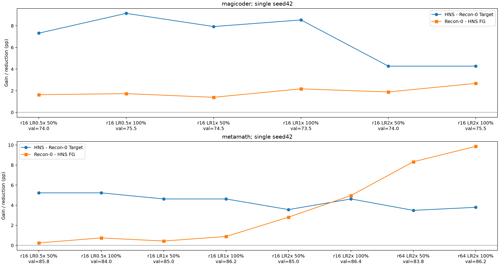

# R2-O1: completed results

Status: complete. All prespecified conditions are reported.

| Condition | Method | Target | Off | FG |
| --- | --- | ---: | ---: | ---: |
| magicoder_r16_lr0.5_fraction0.5 | original_lora | 65.2439 | 77.6819 | 2.0362 |
| magicoder_r16_lr0.5_fraction0.5 | recon_0 | 65.8537 | 78.0761 | 1.6301 |
| magicoder_r16_lr0.5_fraction0.5 | hns_f4_s1 | 73.1707 | 80.7765 | 0.0000 |
| magicoder_r16_lr0.5_fraction0.5 | flat_nuclear | 71.9512 | 81.0820 | 0.0000 |
| magicoder_r16_lr0.5_fraction1 | original_lora | 64.0244 | 77.5627 | 2.1262 |
| magicoder_r16_lr0.5_fraction1 | recon_0 | 64.0244 | 77.9787 | 1.7281 |
| magicoder_r16_lr0.5_fraction1 | hns_f4_s1 | 73.1707 | 80.5574 | 0.0000 |
| magicoder_r16_lr0.5_fraction1 | flat_nuclear | 73.1707 | 80.4974 | 0.0000 |
| magicoder_r16_lr1_fraction0.5 | original_lora | 64.6341 | 78.2946 | 1.4390 |
| magicoder_r16_lr1_fraction0.5 | recon_0 | 65.8537 | 78.3328 | 1.3916 |
| magicoder_r16_lr1_fraction0.5 | hns_f4_s1 | 73.7805 | 80.5552 | 0.0000 |
| magicoder_r16_lr1_fraction0.5 | flat_nuclear | 75.6098 | 80.9004 | 0.0000 |
| magicoder_r16_lr1_fraction1 | original_lora | 63.4146 | 77.5507 | 2.2068 |
| magicoder_r16_lr1_fraction1 | recon_0 | 64.0244 | 77.5963 | 2.1705 |
| magicoder_r16_lr1_fraction1 | hns_f4_s1 | 72.5610 | 80.7575 | 0.0000 |
| magicoder_r16_lr1_fraction1 | flat_nuclear | 73.7805 | 81.0690 | 0.0000 |
| magicoder_r16_lr2_fraction0.5 | original_lora | 69.5122 | 78.2541 | 1.4390 |
| magicoder_r16_lr2_fraction0.5 | recon_0 | 71.3415 | 77.8139 | 1.8845 |
| magicoder_r16_lr2_fraction0.5 | hns_f4_s1 | 75.6098 | 81.2896 | 0.0000 |
| magicoder_r16_lr2_fraction0.5 | flat_nuclear | 75.0000 | 81.2439 | 0.0000 |
| magicoder_r16_lr2_fraction1 | original_lora | 70.1220 | 76.3508 | 3.4028 |
| magicoder_r16_lr2_fraction1 | recon_0 | 70.7317 | 77.0810 | 2.6745 |
| magicoder_r16_lr2_fraction1 | hns_f4_s1 | 75.0000 | 81.1413 | 0.0000 |
| magicoder_r16_lr2_fraction1 | flat_nuclear | 75.0000 | 81.3365 | 0.0000 |
| metamath_r16_lr0.5_fraction0.5 | original_lora | 82.6384 | 72.8530 | 0.3265 |
| metamath_r16_lr0.5_fraction0.5 | recon_0 | 82.7900 | 73.3448 | 0.2465 |
| metamath_r16_lr0.5_fraction0.5 | hns_f4_s1 | 88.0212 | 75.3837 | 0.0000 |
| metamath_r16_lr0.5_fraction0.5 | flat_nuclear | 87.8696 | 75.9202 | 0.0000 |
| metamath_r16_lr0.5_fraction1 | original_lora | 83.0174 | 74.8773 | 0.0000 |
| metamath_r16_lr0.5_fraction1 | recon_0 | 82.8658 | 73.6256 | 0.7394 |
| metamath_r16_lr0.5_fraction1 | hns_f4_s1 | 88.0970 | 76.6837 | 0.0000 |
| metamath_r16_lr0.5_fraction1 | flat_nuclear | 88.2487 | 75.6632 | 0.0000 |
| metamath_r16_lr1_fraction0.5 | original_lora | 83.6998 | 73.0545 | 0.3081 |
| metamath_r16_lr1_fraction0.5 | recon_0 | 83.4723 | 72.7323 | 0.4313 |
| metamath_r16_lr1_fraction0.5 | hns_f4_s1 | 88.0970 | 75.7532 | 0.0000 |
| metamath_r16_lr1_fraction0.5 | flat_nuclear | 87.4147 | 76.0729 | 0.0000 |
| metamath_r16_lr1_fraction1 | original_lora | 83.6998 | 72.1522 | 0.9178 |
| metamath_r16_lr1_fraction1 | recon_0 | 83.6240 | 72.1719 | 0.8810 |
| metamath_r16_lr1_fraction1 | hns_f4_s1 | 88.2487 | 76.2122 | 0.0000 |
| metamath_r16_lr1_fraction1 | flat_nuclear | 88.4003 | 75.4769 | 0.0000 |
| metamath_r16_lr2_fraction0.5 | original_lora | 84.4579 | 67.9775 | 5.0693 |
| metamath_r16_lr2_fraction0.5 | recon_0 | 84.0788 | 68.8264 | 4.2315 |
| metamath_r16_lr2_fraction0.5 | hns_f4_s1 | 87.6422 | 72.2760 | 1.4228 |
| metamath_r16_lr2_fraction0.5 | flat_nuclear | 87.7938 | 73.0110 | 0.5297 |
| metamath_r16_lr2_fraction1 | original_lora | 84.7612 | 67.0764 | 5.9255 |
| metamath_r16_lr2_fraction1 | recon_0 | 84.5337 | 68.0421 | 4.9645 |
| metamath_r16_lr2_fraction1 | hns_f4_s1 | 89.1585 | 74.2772 | 0.0000 |
| metamath_r16_lr2_fraction1 | flat_nuclear | 88.3245 | 73.8269 | 0.0000 |
| metamath_r64_lr2_fraction0.5 | original_lora | 84.4579 | 64.7109 | 8.2305 |
| metamath_r64_lr2_fraction0.5 | recon_0 | 84.4579 | 64.6094 | 8.3320 |
| metamath_r64_lr2_fraction0.5 | hns_f4_s1 | 87.9454 | 74.4165 | 0.0000 |
| metamath_r64_lr2_fraction0.5 | flat_nuclear | 88.2487 | 75.0750 | 0.0000 |
| metamath_r64_lr2_fraction1 | original_lora | 85.2919 | 63.3601 | 9.5813 |
| metamath_r64_lr2_fraction1 | recon_0 | 85.4435 | 63.0750 | 9.8664 |
| metamath_r64_lr2_fraction1 | hns_f4_s1 | 89.2343 | 74.8373 | 0.0000 |
| metamath_r64_lr2_fraction1 | flat_nuclear | 89.0826 | 74.5768 | 0.1848 |

Target/Off are percentages; FG/differences are pp. Off averages3 non-target families equally; FG clips each family before averaging. Commonsense is an equal8-subtask macro.

All20,000-draw paired intervals and wins/ties/losses or exact McNemar repair/damage counts are in paired_ci.tsv. Single-seed, paired question-level intervals; no training-run inference.

Source/config/weight SHA256, module coverage, reconstruction errors and ordered per-sample input hashes passed. All CUDA/model work ran through Slurm; at most2 allocated GPUs. Builders exited before vLLM began. Commands, timings, job IDs and logs are in commands_*.json. See protocol.md for fixed settings.

## Training state curve

All12 rank16 candidates and both rank64 checkpoints are shown. Validation is never used to select reported test conditions. See validation_gain_spearman.tsv for tied-rank Spearman correlations and descriptive permutation p-values. Pooled task validation scores have different meanings; within-task rank16 comparisons are the primary correlations.
- pooled_all, target_gain: rho=-0.3750009177533887, n=14.
- pooled_all, fg_reduction: rho=0.05518817584457587, n=14.
- rank16, target_gain: rho=-0.3492068923153885, n=12.
- rank16, fg_reduction: rho=-0.1405994937689191, n=12.
- magicoder_rank16, target_gain: rho=0.0, n=6.
- magicoder_rank16, fg_reduction: rho=0.0, n=6.
- metamath_rank16, target_gain: rho=0.08823529411764706, n=6.
- metamath_rank16, fg_reduction: rho=0.40583972495671394, n=6.
