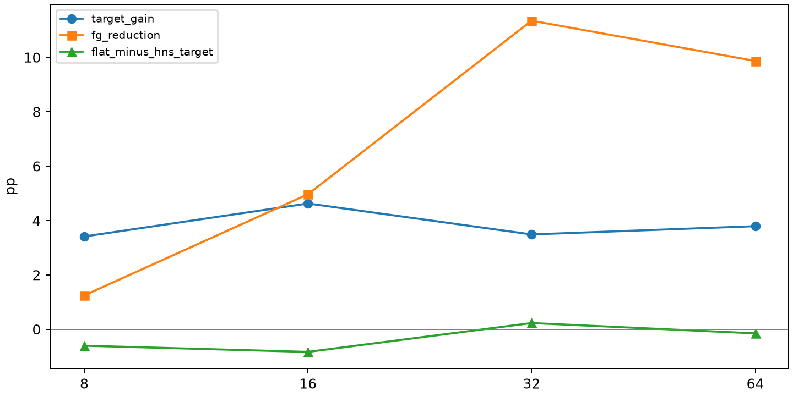

# R2-O6: completed results

Status: complete. All prespecified conditions are reported.

| Condition | Method | Target | Off | FG |
| --- | --- | ---: | ---: | ---: |
| Qwen3-8B_metamath_lora_r8_seed42 | original_lora | 84.0030 | 71.1279 | 1.8135 |
| Qwen3-8B_metamath_lora_r8_seed42 | recon_0 | 84.2305 | 71.6986 | 1.2443 |
| Qwen3-8B_metamath_lora_r8_seed42 | hns_f4_s1 | 87.6422 | 75.4726 | 0.0000 |
| Qwen3-8B_metamath_lora_r8_seed42 | flat_nuclear | 87.0356 | 74.9091 | 0.0000 |
| Qwen3-8B_metamath_lora_r32_seed42 | original_lora | 85.0644 | 61.8199 | 11.1215 |
| Qwen3-8B_metamath_lora_r32_seed42 | recon_0 | 84.4579 | 61.5952 | 11.3462 |
| Qwen3-8B_metamath_lora_r32_seed42 | hns_f4_s1 | 87.9454 | 73.9749 | 0.0000 |
| Qwen3-8B_metamath_lora_r32_seed42 | flat_nuclear | 88.1729 | 74.4871 | 0.0000 |
| Qwen3-8B_metamath_lora_r16_seed42 | original_lora | 84.7612 | 67.0764 | 5.9255 |
| Qwen3-8B_metamath_lora_r16_seed42 | recon_0 | 84.5337 | 68.0421 | 4.9645 |
| Qwen3-8B_metamath_lora_r16_seed42 | hns_f4_s1 | 89.1585 | 74.2772 | 0.0000 |
| Qwen3-8B_metamath_lora_r16_seed42 | flat_nuclear | 88.3245 | 73.8269 | 0.0000 |
| Qwen3-8B_metamath_lora_r64_seed42 | original_lora | 85.2919 | 63.3601 | 9.5813 |
| Qwen3-8B_metamath_lora_r64_seed42 | recon_0 | 85.4435 | 63.0750 | 9.8664 |
| Qwen3-8B_metamath_lora_r64_seed42 | hns_f4_s1 | 89.2343 | 74.8373 | 0.0000 |
| Qwen3-8B_metamath_lora_r64_seed42 | flat_nuclear | 89.0826 | 74.5768 | 0.1848 |

Target/Off are percentages; FG/differences are pp. Off averages3 non-target families equally; FG clips each family before averaging. Commonsense is an equal8-subtask macro.

All20,000-draw paired intervals and wins/ties/losses or exact McNemar repair/damage counts are in paired_ci.tsv. Single-seed, paired question-level intervals; no training-run inference.

Source/config/weight SHA256, module coverage, reconstruction errors and ordered per-sample input hashes passed. All CUDA/model work ran through Slurm; at most2 allocated GPUs. Builders exited before vLLM began. Commands, timings, job IDs and logs are in commands_*.json. See protocol.md for fixed settings.

All new sources use E4 validation-selected fixed learning rates; no new LR tuning. Warmup is explicit10% steps, verified in saved arguments and actual Trainer schedule. New trainings use a predeclared final checkpoint. See training_audit.json and training_commands_*.json for hashes, actual steps, GPU time/logs.

Single seed42; per-condition paired question-level intervals. Ranks16/64 reuse E4 audited cells.
