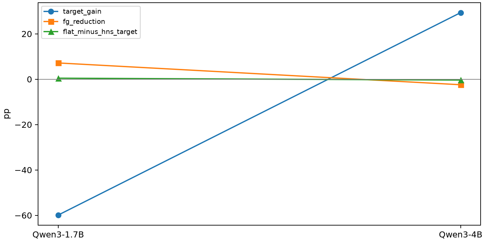

# R2-O7: completed results

Status: complete. All prespecified conditions are reported.

| Condition | Method | Target | Off | FG |
| --- | --- | ---: | ---: | ---: |
| Qwen3-1.7B_metamath_lora_r16_seed42 | original_lora | 65.2009 | 44.4578 | 19.2567 |
| Qwen3-1.7B_metamath_lora_r16_seed42 | recon_0 | 65.1251 | 44.0216 | 19.6930 |
| Qwen3-1.7B_metamath_lora_r16_seed42 | hns_f4_s1 | 5.2312 | 51.1858 | 12.5287 |
| Qwen3-1.7B_metamath_lora_r16_seed42 | flat_nuclear | 5.6861 | 51.3039 | 12.4107 |
| Qwen3-4B_metamath_lora_r16_seed42 | original_lora | 54.2835 | 63.4792 | 5.0157 |
| Qwen3-4B_metamath_lora_r16_seed42 | recon_0 | 56.6338 | 63.5742 | 5.1240 |
| Qwen3-4B_metamath_lora_r16_seed42 | hns_f4_s1 | 85.9742 | 61.1417 | 7.5629 |
| Qwen3-4B_metamath_lora_r16_seed42 | flat_nuclear | 85.5951 | 61.5765 | 7.1281 |

Target/Off are percentages; FG/differences are pp. Off averages3 non-target families equally; FG clips each family before averaging. Commonsense is an equal8-subtask macro.

All20,000-draw paired intervals and wins/ties/losses or exact McNemar repair/damage counts are in paired_ci.tsv. Single-seed, paired question-level intervals; no training-run inference.

Source/config/weight SHA256, module coverage, reconstruction errors and ordered per-sample input hashes passed. All CUDA/model work ran through Slurm; at most2 allocated GPUs. Builders exited before vLLM began. Commands, timings, job IDs and logs are in commands_*.json. See protocol.md for fixed settings.

All new sources use E4 validation-selected fixed learning rates; no new LR tuning. Warmup is explicit10% steps, verified in saved arguments and actual Trainer schedule. New trainings use a predeclared final checkpoint. See training_audit.json and training_commands_*.json for hashes, actual steps, GPU time/logs.

Single seed42; per-condition paired question-level intervals. Small-model learning rate was transferred from8B without separate tuning; both Base results were newly evaluated.
